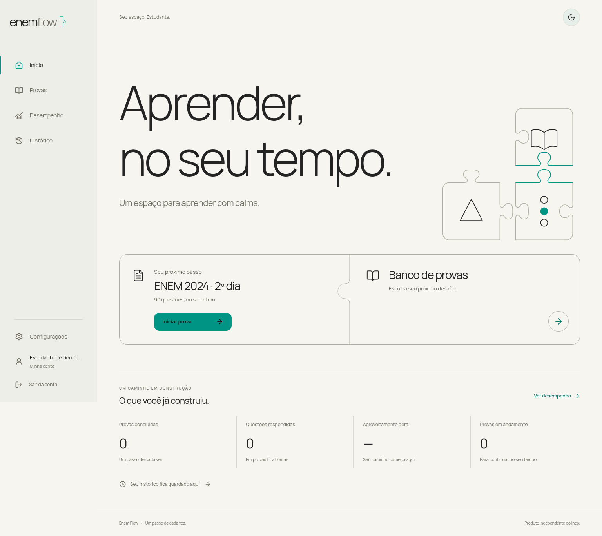

# Enem Flow

MVP local da plataforma descrita no [plano do projeto](docs/plano-implementacao/enem_adaptativo_plano_do_projeto.md): conta individual, provas oficiais, respostas editáveis, correção, histórico, painel e curadoria versionada. A consolidação técnica da primeira entrega está concluída; o [status atual](docs/plano-implementacao/status-implementacao.md) reúne as funcionalidades, validações e pendências.



Novas provas têm um [fluxo geral de preparação](docs/preparacao-provas.md): a curadoria prepara JSON automaticamente e o comando offline aceita PDFs com manifesto, gerando texto nativo, fórmulas, figuras vinculadas e relatório de revisão.

## Executar localmente

Requisitos: Python 3.13 ou 3.14, Node.js 22 e npm. A execução local usa SQLite e não exige contas externas. Fontes e conteúdo estão incluídos no projeto.

```bash
make setup
```

Em dois terminais, na raiz:

```bash
make api
```

```bash
make web
```

Acesse **http://localhost:3000** e crie sua conta. A documentação interativa da API fica em **http://localhost:8000/docs**. Não existe senha administrativa padrão.

Se preferir `uv`, crie o ambiente com `uv venv .venv` e instale com `uv pip install --python .venv/bin/python -r backend/requirements-dev.lock`; depois execute `make migrate seed` e `npm ci` em `frontend/`.

Para usar um build de produção local, mantenha a API iniciada e execute em outro terminal:

```bash
cd frontend
npm run build
npm run start
```

Ao alterar o frontend nessa modalidade, gere um novo build e reinicie esse processo. Uma instalação existente recebe as versões revisadas do caderno com `make seed`; faça [backup](docs/operations.md) antes de atualizar seu banco.

## Executar com PostgreSQL e Docker

```bash
cp .env.example .env
# Defina POSTGRES_PASSWORD em .env antes de iniciar.
docker compose up --build
```

Abra **http://localhost:3000**. Migrações e importação do conjunto revisado são executadas no início, sem duplicar conteúdo. PostgreSQL e imagens têm volumes persistentes; a API fica na rede interna dos contêineres.

A instalação isolada foi validada com Compose sobre Podman e o CI inclui um ensaio com Docker Engine, incluindo recriação dos contêineres sem remover volumes. Consulte [procedimentos, evidências e limites](docs/primeira-entrega.md).

## O que está implementado

- Cadastro, login, sessão por cookie HttpOnly, saída, preferências e recuperação assistida por link de uso único.
- Catálogo com busca e filtros por ano, área, aplicação e caderno; distinção entre caderno completo, seção e coleção.
- Caderno oficial completo **ENEM 2024, segundo dia, azul: 90 questões**. Original e gabarito preservados com SHA-256. A questão 129 está anulada e não entra no desempenho.
- Enunciados e alternativas selecionáveis a partir do JSON; tabelas HTML e fórmulas matemáticas/químicas em LaTeX com KaTeX, mhchem e MathML.
- Figuras com legendas, fontes e rodapé de equações associados; ampliação dentro da página, com zoom, Escape e retorno do foco.
- Navegação por botões, mapa e setas **← / →**, respeitando primeira e última questão e voltando ao topo a cada troca. Quando o foco está nas alternativas, as setas preservam sua seleção nativa.
- Alteração e limpeza de alternativas, salvamento no servidor e retomada após fechar ou recarregar.
- Confirmação de conclusão, correção objetiva, revisão por questão e finalização transacional e idempotente.
- Histórico individual, evolução e painel por área, matéria, tema e habilidade, com quantidade de tentativas e cobertura dos rótulos.
- Preparação generalizada de novas provas: normalização conservadora de notação, associação de figuras/legendas e relatórios de transformações e ambiguidades, com CLI para JSON ou PDF textual com manifesto.
- Curadoria: preparação automática na importação/edição, comparação com a fonte, novas versões, aprovação, publicação/retirada e consulta das decisões. Pendências bloqueantes impedem aprovação e publicação.
- Migração inicial, configuração Docker, testes críticos da API e testes de navegador em desktop e viewport móvel.

O lote de apresentação de **31/10/2026** alterou as questões **91, 92, 94, 97, 99, 100, 114, 116, 118, 123, 128, 132, 133, 135 e 170**, preservando gabaritos e histórico. O [registro técnico da revisão](data/README.md#revisão-de-apresentação) reúne os motivos, páginas da fonte, evidências e limites.

As classificações temáticas e habilidades não foram inventadas: o conjunto inicial tem área e a disciplina Matemática identificadas pelo próprio caderno. Os demais rótulos ficam explicitamente pendentes. Classificadores, adaptação, tutor com LLM e layouts dinâmicos pertencem às próximas etapas.

## Curadoria

```bash
.venv/bin/python -m backend.app.cli create-admin seu-email@exemplo.com
```

A senha é solicitada no terminal. Em Docker: `docker compose exec api python -m backend.app.cli create-admin seu-email@exemplo.com`. Entre com essa conta para acessar **Curadoria**. Novas importações sempre entram como rascunho; todas as versões precisam de aprovação antes de publicar.

## Preparar novas provas

Para um JSON no [contrato de importação](docs/content-schema.json):

```bash
.venv/bin/python scripts/prepare_exam.py \
  --input caminho/prova.json \
  --output tmp/prova-preparada.json \
  --report tmp/prova-preparada.report.json
```

Para um PDF textual, adapte o [manifesto de exemplo](data/examples/manifesto-prova.json) com identificador, metadados, áreas e configuração de layout:

```bash
.venv/bin/python scripts/prepare_exam.py \
  --manifest caminho/manifesto.json \
  --pdf caminho/prova.pdf \
  --answer-key caminho/gabarito.pdf \
  --output tmp/prova-preparada.json
```

Confira o relatório, os recursos em `data/assets/` e as questões contra a fonte antes de importar o JSON preparado pela Curadoria. A importação pela interface também aplica a preparação; `POST /admin/imports/prepare` permite obter uma prévia sem gravar no banco. A CLI não publica provas nem substitui entradas; saídas existentes exigem `--force`.

As regras são reutilizáveis e registram transformações e ambiguidades. Fórmulas espaciais incompletas, relações de figuras inferidas e PDFs digitalizados ainda exigem tratamento e revisão; OCR não está automatizado nesse fluxo. O catálogo continua com um caderno: a generalização da preparação não adiciona outras provas por si só.

## Verificar

```bash
make test
make build
npm --prefix frontend run check:content
```

Com API e frontend iniciados:

```bash
cd frontend
npx playwright install chromium
npm run test:e2e
```

Para usar o Chrome já instalado, configure `PLAYWRIGHT_CHROMIUM_EXECUTABLE=/caminho/do/google-chrome`. Os testes de navegador criam contas descartáveis e excluem seus históricos ao concluir. Para PostgreSQL, use `TEST_DATABASE_URL` apontando para um **banco exclusivo de testes com `test` no nome**; a suíte cria e remove suas tabelas.

Use também um banco separado para os testes de navegador. As [validações e seus limites](docs/plano-implementacao/status-implementacao.md#validação-e-limites) distinguem a revisão de apresentação, os ajustes de navegação e a preparação generalizada. A consolidação inclui instalação isolada, PostgreSQL, recuperação, acessibilidade automatizada e CI. Revisão pedagógica independente, leitores de tela e aparelhos reais estão no final das próximas etapas; publicação e piloto permanecem sujeitos a esses aceites.

## Documentação da entrega

- [Plano do projeto em Markdown](docs/plano-implementacao/enem_adaptativo_plano_do_projeto.md)
- [O que foi feito e o que falta](docs/plano-implementacao/status-implementacao.md)
- [Próximas etapas](docs/plano-implementacao/proximas-etapas.md)
- [Escopo, critérios de aceite e validação](docs/primeira-entrega.md)
- [Arquitetura, contratos e decisões](docs/architecture.md)
- [Operação, backup e recuperação](docs/operations.md)
- [Origem do conteúdo e conferência](data/README.md)
- [Contrato JSON de importação](docs/content-schema.json)
- [Design implementado — Conhecimento em construção](docs/propostas-design/README.md)
- [Interface em tema escuro](docs/screenshots/desktop-escuro.png)
- [Visualização em celular](docs/screenshots/mobile.png)
- [Questão com texto nativo no celular](docs/screenshots/questao-mobile.png)
- [Vídeo da jornada completa](docs/demo.webm)
- [Vídeo das figuras e fórmulas em LaTeX](docs/demo-figuras.webm)
- [Questão 92 com química em LaTeX no celular](docs/screenshots/questao-92-latex-mobile.png)
- [Ampliação de figura dentro do site](docs/screenshots/ampliacao-figura.png)

Código sob a licença MIT. Textos, figuras e provas de terceiros conservam a origem e os direitos de seus respectivos titulares; consulte a documentação do conjunto. Produto independente, sem vínculo ou endosso do Inep.
