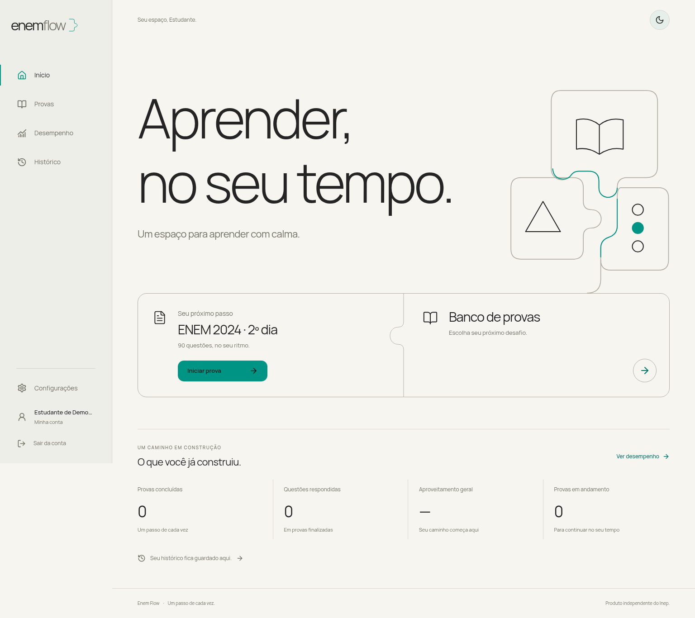

# Enem Flow

Plataforma local de estudos para o ENEM: provas oficiais, respostas salvas, correção, histórico, diagnóstico e prática adaptativa.



## Executar localmente

Requisitos: **Python 3.13 ou 3.14**, **Node.js 22** e npm. A instalação local usa SQLite e dispensa Docker e contas externas.

```bash
make setup
```

O comando instala as dependências, aplica as migrações e prepara **seis provas regulares de 2024/2025**, caderno azul: Inglês e Espanhol no 1º dia e uma prova do 2º dia de cada ano. São **540 posições de questões**, com itens comuns às duas opções de língua. As cinco provas extraídas automaticamente foram conferidas pela equipe com o caderno e o gabarito originais. Todas aparecem como **Disponível**.

Inicie os dois serviços juntos:

```bash
make dev
```

`Ctrl+C` encerra os dois processos. Para iniciá-los separadamente, use `make api` e `make web` em terminais distintos. `make doctor` confere a instalação sem modificar o banco.

O fluxo é suportado em Linux/WSL, com Git, Make e as versões de Python/Node acima instaladas. O setup usa os lockfiles, verifica os arquivos distribuídos e cria backup antes de atualizar um banco SQLite existente. Falhas interrompem a etapa e permitem repetir o comando. A instalação nova não copia contas nem respostas do desenvolvedor e não baixa o acervo histórico.

Abra **http://localhost:3000** e crie sua conta. A documentação da API fica em **http://localhost:8000/docs**. Use `Ctrl+C` nos terminais para encerrar.

Alternativa com `uv`:

```bash
uv venv .venv
make setup
```

Para atualizar uma instalação existente, faça [backup](docs/operations.md#backup-local-com-sqlite) e execute `make migrate seed`. O catálogo preserva versões, respostas, resultados e decisões manuais. A seção de Matemática de 2023 do bootstrap anterior fica fora do catálogo público; seus dados e arquivos de referência são mantidos. Uma publicação manual dessa seção é preservada.

Para servir um build de produção local, mantenha a API iniciada:

```bash
npm --prefix frontend run build
npm --prefix frontend run start
```

Mudanças posteriores exigem novo build e reinício do frontend.

## Docker e PostgreSQL

```bash
cp .env.example .env
# Defina POSTGRES_PASSWORD em .env.
docker compose up --build
```

O site usa a porta **3000**, com Nginx como entrada e API, Next.js e PostgreSQL nas redes internas. Banco e figuras ficam em volumes persistentes.

A imagem Docker inclui **os dois lotes conferidos**: 2024 dia 2 e Matemática 2023. Os cinco cadernos extraídos de 2024/2025 incluídos no Git pertencem ao fluxo local e continuam fora da imagem, conforme a decisão de `7b84843`. Consulte [operação](docs/operations.md) para redes, volumes, backup e recuperação.

## Conteúdo e funcionalidades

- Catálogo com filtros; enunciados selecionáveis, tabelas, figuras e fórmulas matemáticas e químicas em LaTeX.
- Respostas editáveis e persistentes, retomada, finalização idempotente, correção e histórico individual.
- Painel por área e tema, diagnóstico e prática adaptativa com o motivo de cada questão.
- Tutor na prática: orientação, pista e resolução a partir de material aprovado pela curadoria, com IA opcional (Groq ou outra API compatível com a OpenAI).
- Curadoria com importação, edição versionada e trilha de decisões; preparação offline de JSON e PDF.
- Experimentos de classificação e layout, sem chamadas a provedores externos.

Os selos **Disponível** indicam que a prova pode ser iniciada. A proveniência das extrações e os relatórios permanecem nos dados; avisos específicos de apresentação continuam vinculados à página original. O gabarito só aparece após finalizar. Não há cálculo TRI.

Para ativar a IA do tutor, copie `.env.example` para `.env`, preencha `GROQ_API_KEY` e confira modelo e preços. Sem a chave, a curadoria escreve o material e a prática o mostra sem reformulação.

Os lotes de referência somam 135 questões conferidas: 90 do 2º dia de 2024 e 45 de Matemática de 2023. A taxonomia, as anotações e os experimentos continuam disponíveis mesmo quando um lote não está no catálogo público. Consulte [dados e fontes](data/README.md).

Para criar uma conta de curadoria, sem senha administrativa padrão:

```bash
.venv/bin/python -m backend.app.cli create-admin seu-email@exemplo.com
```

A senha é solicitada no terminal. Em Docker, use `docker compose exec api python -m backend.app.cli create-admin seu-email@exemplo.com`.

## Verificar e manter

```bash
make test
make lint
make build
```

`make test` executa pytest, TypeScript e `make check-distribution`: contratos, hashes, recursos e LaTeX de todas as provas distribuídas, incluindo a referência de 2023. `make format` aplica Ruff e Prettier. `make clean` remove caches Python, relatórios de navegador e o cache incremental do TypeScript; mantém banco, backups, provas, dependências e o servidor em execução.

Com serviços iniciados **em um banco isolado de testes**:

```bash
npm --prefix frontend exec -- playwright install chromium
npm --prefix frontend run test:e2e
```

Para usar o Chrome instalado, defina `PLAYWRIGHT_CHROMIUM_EXECUTABLE=/caminho/do/google-chrome` e instale o gravador com `npm --prefix frontend exec -- playwright install ffmpeg`. Para PostgreSQL, `TEST_DATABASE_URL` deve apontar para um banco exclusivo com `test` no nome; a suíte cria e remove suas tabelas. Veja [os procedimentos e limites das validações](docs/validation.md).

O acervo histórico é opcional e precisa ser reconstruído pelos manifestos. `make acervo` gera e instala as provas históricas disponíveis; `make experiments` reproduz os experimentos incluídos. Esses fluxos e seus pré-requisitos estão em [preparação de provas](docs/preparacao-provas.md), [fontes oficiais](data/sources/README.md) e [experimentos](docs/experimentos/README.md).

## Documentação

- [Estado atual e validações](docs/plano-implementacao/status-implementacao.md) e [próximas etapas](docs/plano-implementacao/proximas-etapas.md).
- [Validação e testes](docs/validation.md).
- [Arquitetura e contratos](docs/architecture.md), [operação](docs/operations.md) e [contrato de importação](docs/content-schema.json).
- [Banco e classificação](docs/banco-classificacao.md), [cobertura do acervo](docs/cobertura-acervo.md) e [auditoria histórica](docs/experimentos/auditoria-acervo.md).
- [Diagnóstico e estado do aluno](docs/diagnostico-estado.md), [política adaptativa](docs/politica-adaptativa.md) e [design](docs/propostas-design/README.md).

Código sob licença MIT. Provas e figuras de terceiros conservam sua origem e seus direitos. Produto independente, sem vínculo ou endosso do Inep.
