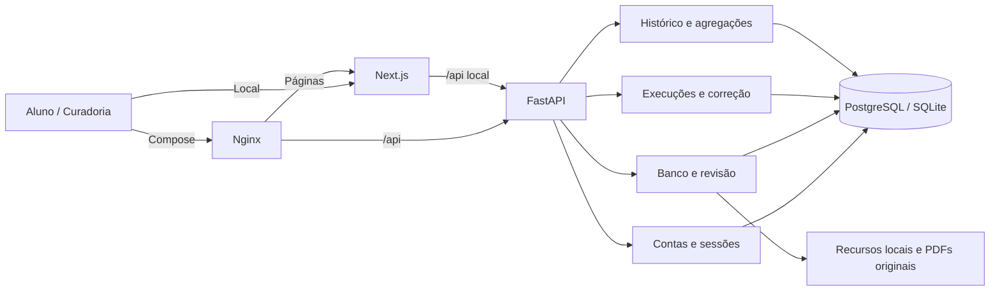

# Arquitetura da primeira entrega

Monólito modular em dois processos: Next.js 16 / React 19 / TypeScript para a experiência e FastAPI / SQLAlchemy para domínio, autorização e persistência. Os manifests têm versões diretas fixadas e os lockfiles do npm e Python fixam também as transitivas. PostgreSQL é a referência de implantação. SQLite, com WAL e chaves estrangeiras, permite desenvolvimento local sem serviços extras.

No modo local, o frontend encaminha `/api/*` para a API configurada por `API_INTERNAL_URL`. Esse destino é definido no build de produção; ao mudá-lo, gere um novo build. No Compose, o gateway Nginx encaminha páginas ao Next e `/api/*` à API, substituindo cabeçalhos de origem recebidos do cliente. Somente o gateway é um proxy confiável da API. O navegador usa uma única origem, sem tokens em localStorage ou exposição de credenciais de banco. As fontes são servidas pelo próprio frontend.

A unidade de trabalho confirma a transação antes de enviar a resposta HTTP, usando o [escopo de função das dependências FastAPI](https://fastapi.tiangolo.com/tutorial/dependencies/dependencies-with-yield/#early-exit-and-scope). Uma falha de commit pode assim retornar erro ao cliente antes de indicar sucesso.

## Limites e contratos

`schemas/content.py` define o contrato 1.0 de conteúdo: ocorrência, versão, enunciado, imagens com descrição, alternativas, área, rótulos, página e layout separado. O campo opcional `blocks` estende o contrato com parágrafos, imagens, tabelas e fórmulas tipados, sem quebrar importações antigas. O texto do JSON é renderizado como HTML; KaTeX usa entrada não confiável, expansão limitada e saída HTML/MathML. Não se aceita HTML arbitrário. O gabarito existe apenas no backend até a conclusão. As respostas públicas usam uma lista explícita de campos permitidos; o layout e os links de gabarito não são expostos durante a prova.

Fórmulas explícitas usam `$...$`, `$$...$$`, `\(...\)` ou `\[...\]`; química usa mhchem (`\ce{...}`). Texto comum permanece selecionável. `image.caption`, `image.credit` e `image.equations` associam legenda, fonte e rodapé matemático à figura em `figure`/`figcaption`. A mesma apresentação acompanha a ampliação em diálogo nativo, com zoom e rolagem internos, Escape e restauração do foco. Não há navegação para uma nova guia ao ampliar.

`services/presentation.py` adapta apenas snapshots antigos conhecidos que coincidam pelo SHA-256 do conteúdo completo normalizado pelo contrato. Extração inicial e apresentação native-v1 ficam preservadas em `data/derived/baselines/`. A adaptação também confere número, área, gabarito, anulação, rótulos e página. Substitui somente os campos de apresentação; identificadores, versões, escolhas e resultados permanecem os do snapshot. A atualização do catálogo cria novas versões com `seed --publish-reviewed --refresh-bundled`, recusando edições próprias e alterações de dados de avaliação. O lote native-v2 tem motivos por questão em `layout.presentation_review` e na trilha `reviews` do banco.

`services/content.py` valida recursos existentes, importa rascunhos e impede publicação incompleta ou sem revisão. Correções geram novas versões; a prova fica em revisão até aprovação e republicação. Rejeitar uma versão vinculada a uma prova publicada também suspende sua publicação. A trilha `reviews` guarda autor, ação, justificativa e instante. `services/identity.py` identifica conteúdo igual entre cadernos sem confundir número, ordem das alternativas e letra correta de cada ocorrência. A tabela `canonical_questions` liga identidades às versões; gabaritos conflitantes e duplicatas dentro de uma prova são recusados. A deduplicação de extrações com figuras é conservadora e ainda exige revisão visual.

A edição verifica colisões com assinaturas canônicas conhecidas e duplicidade entre os conteúdos atuais da prova. A publicação repete a verificação de identidades e conteúdo, incluindo versões antigas. Uma correção legítima preserva a identidade estável e os snapshots; copiar outra questão exige resolver a colisão antes de salvar ou publicar.

`installers/generated.py` é a exceção explícita de publicação automática local: admite pendências de preparação, preserva os relatórios e registra origem e revisão pendente em `source.automatic_archive`. `content_quality` leva esse estado ao catálogo e ao snapshot da prova; `preparation_errors` expõe apenas a contagem de erros da questão, sem abrir layout interno ou gabarito. O site identifica esses cadernos e vincula as pendências à fonte. O fluxo manual mantém seus bloqueios. O resumo do catálogo consulta apenas identificador, estado e área das versões, sem carregar os enunciados completos.

`exam_runs` fixa ordem, conteúdo completo, versão e metadados da prova no início. Isso preserva também as tentativas ainda abertas quando uma questão é corrigida ou uma prova é retirada. O resultado, as escolhas definitivas e os eventos são registrados na mesma transação.

Antes de alterar respostas ou finalizar, um UPDATE inócuo adquire o bloqueio da execução. Funciona no PostgreSQL e no SQLite, onde SELECT FOR UPDATE seria ignorado. A finalização verifica o estado após obter o bloqueio: chamadas concorrentes retornam o mesmo resultado, com uma única série de eventos. O início usa chave de idempotência única por usuário; reutilizá-la para outra prova retorna conflito.

`services/scoring.py` corrige exclusivamente por gabarito: brancos contam no denominador e não como respostas; anuladas ficam fora do desempenho. O painel soma tentativas de provas concluídas, inclusive repetições; não deduplica um item que o aluno resolveu novamente. Rótulos múltiplos podem sobrepor grupos. Cobertura significa a fração de tentativas válidas com pelo menos um rótulo do tipo considerado, não domínio de conhecimento.

## Preparação de conteúdo

`backend/app/preparation/` é o preparador compartilhado de JSON, sem dependência de PDF/Node nas requisições da API e sem regras por número de questão. `POST /admin/imports` e a edição de versões o executam automaticamente; `/admin/imports/prepare` oferece prévia sem gravação. Converte notação reconhecida, associa blocos adjacentes às figuras e registra hashes, operações e pendências em `layout.preparation`. Agrupamentos/delimitadores LaTeX inválidos e perdas de layout conhecidas bloqueiam aprovação e publicação. Os avisos ficam na curadoria; o aluno recebe a lista permitida de campos de apresentação.

O fingerprint permite reaproveitar apresentação e operações anteriores, mas não autentica a auditoria recebida. A validação independente examina os campos renderizados, imagens sem posição e diagnósticos de extração. Aprovação e publicação também a executam para impedir que relatórios alterados ou antigos suprimam bloqueios. O catálogo pode publicar uma instalação anterior sem criar novas versões; retiradas, rejeições e edições manuais pendentes permanecem preservadas.

O adaptador offline `scripts/exam_pdf.py` usa PyMuPDF, regiões, cabeçalhos, posição dos caracteres e marcadores A–E para preparar PDFs textuais. `scripts/prepare_exam.py` aceita JSON ou manifesto, produz um rascunho e relatório, confere recursos e compila o LaTeX com o KaTeX/mhchem do frontend. Saída automática não equivale a aprovação. [Uso e limites](preparacao-provas.md).

## HTTP

A especificação OpenAPI executável está em `/openapi.json` e `/docs` na API. Erros usam `detail`; validações acrescentam `errors`, sem devolver a entrada bruta de senhas.

O backend segue a organização de [aplicações maiores do FastAPI](https://fastapi.tiangolo.com/pt/tutorial/bigger-applications/), com dependências declaradas via `Annotated`, como no [tutorial de bancos SQL](https://fastapi.tiangolo.com/pt/tutorial/sql-databases/). Os caminhos abaixo são relativos a `backend/app/`.

| Caminho | Responsabilidade |
| --- | --- |
| `main.py` | Monta a aplicação: ciclo de vida, middleware, tratamento de validação, arquivos de `/assets`, descrições das tags e inclusão dos routers. |
| `middleware.py` | Política de requisições: origem e tamanho, cabeçalhos de segurança e log de acesso, num só middleware para manter a ordem. |
| `dependencies.py` | `SessionDep`, `CurrentUser` e `AdminUser`. |
| `core/` | `config.py` (caminhos e variáveis de ambiente), `db.py` (engine, `Base`, unidade de trabalho) e `security.py` (senhas, sessão por cookie, usuário atual e papel de curadoria). |
| `models/` | Tabelas por domínio: `accounts.py`, `content.py` e `runs.py`. O pacote registra todas no `Base.metadata`. |
| `schemas/` | Esquemas de requisição por funcionalidade: `account.py`, `content.py` (contrato JSON), `runs.py` e `curation.py`. O pacote reexporta todos, e os scripts continuam importando de `backend.app.schemas`. |
| `routers/` | Uma funcionalidade por arquivo: `health.py`, `auth.py`, `account.py`, `exams.py`, `runs.py` e `progress.py`. Em `admin/`, ficam `content.py` (importação, edição, revisão, publicação e auditoria) e `archive.py` (acervo e taxonomia). O papel de curadoria é exigido uma vez no router `/admin`. |
| `services/` | Regras de domínio usadas pela API, pela CLI e pelos scripts: `content.py`, `identity.py`, `presentation.py`, `scoring.py`, `taxonomy.py` e `archive_reader.py`. |
| `installers/` | Conteúdo que entra no banco fora da API: `curated.py` (lotes conferidos), `bundled.py` (atualização do conjunto incluído), `generated.py` (publicação automática do acervo) e `assets.py` (figuras no volume do Docker). |
| `preparation/` | Preparador de JSON compartilhado. |
| `cli.py` | Comandos locais (`python -m backend.app.cli`). |

| Operação | Acesso | Comportamento |
| --- | --- | --- |
| `POST /auth/register`, `/auth/login` | Público, limitado por tentativas | Cadastro ou sessão por cookie |
| `POST /auth/logout`, `/auth/reset-password` | Sessão / token de uso único | Revogação; redefinição invalida sessões |
| `GET /me`, `PUT /me/preferences` | Conta | Dados próprios e preferências |
| `GET /exams`, `/exams/{id}` | Público | Somente provas publicadas, sem gabarito |
| `POST /exam-runs` | Conta | Início com `exam_id` e `idempotency_key` |
| `GET /exam-runs/{id}` | Dono da execução | Conteúdo fixado e rascunhos ou resultado |
| `PUT /exam-runs/{id}/answers/{item_id}` | Dono, prova aberta | `choice` A–E ou null para limpar |
| `POST /exam-runs/{id}/finish` | Dono | Finalização transacional, repetível |
| `GET /me/history`, `/me/progress` | Conta | Histórico e agregações próprias |
| `DELETE /me/history` | Conta | Remove execuções e eventos próprios |
| `POST /admin/imports` | Curadoria | Valida JSON e recursos, cria rascunho |
| `GET /admin/exams`, `/admin/exams/{id}` | Curadoria | Inclui conteúdo e estados de revisão |
| `PUT /admin/questions/{version_id}` | Curadoria | Nova versão, com justificativa |
| `POST /admin/reviews/{target_id}` | Curadoria | Aprovar, rejeitar, publicar ou retirar |
| `GET /admin/audit` | Curadoria | Últimas 200 decisões |
| `GET /admin/archive` | Curadoria | Inventário de fontes e cobertura |
| `GET /admin/archive/questions`, `/{occurrence_id}` | Curadoria | Consulta paginada e texto bruto para revisão |
| `GET /admin/taxonomy` | Curadoria | Vocabulário editorial versionado |

Respostas: 401 para sessão inválida; 403 para papel/origem inadequados; 404 para recurso inacessível (inclusive execução alheia); 409 para conflito de estado/idempotência; 422 para contrato inválido; 429 para excesso de autenticações. Os testes verificam essas fronteiras.

## Segurança e continuidade implementadas

Senhas usam scrypt com sal individual; tokens opacos têm apenas o hash persistido. Cookies são HttpOnly e SameSite Strict, com Secure configurável para HTTPS. As mutações validam Origin contra uma lista explícita. Login, cadastro e redefinição têm limite persistido de 30 tentativas por IP em 15 minutos. O IP é guardado como hash; cabeçalhos encaminhados não alteram esse identificador. Em proxy com muitos usuários, planeje limitação por cliente no proxy antes de um piloto maior.

O banco, os arquivos originais e o gabarito nunca entram no diretório público do frontend. A API serve apenas `data/assets`. Campos de importação rejeitam chaves extras; caminhos de recursos não aceitam travessia de diretório. Não há chamadas a provedores de IA nem jobs pesados na requisição do aluno.

Cada requisição recebe `X-Request-ID`, controle de cache e registro de método, caminho, status e latência. A autenticação por recuperação é assistida pelo operador, sem envio de e-mail nesta versão. Observabilidade p50/p95, trabalhadores de extração genérica e provedores externos serão acrescentados conforme o volume exigir.

## Banco histórico e rótulos

O [banco e a classificação](banco-classificacao.md) separam o acervo local de 1998–2025 dos dois lotes conferidos instalados em SQLite/PostgreSQL. `installers/curated.py` valida os hashes das anotações, cria novas versões para os rótulos e mantém os snapshots anteriores. `services/archive_reader.py` lê o banco textual local, sem aprovar ou publicar extrações. A preparação comum permanece em `backend/app/preparation/`, `scripts/exam_pdf.py` e `scripts/prepare_exam.py`; é chamada automaticamente na importação e na edição da curadoria.

Temas editoriais usam `enem-content-v1`. Competências e habilidades oficiais usam outro namespace, como `MT.C3` e `MT.H12`. Propostas de vínculos são metadados privados de curadoria; não são promovidas a habilidades publicadas sem segunda revisão. O conjunto exploratório de Matemática contém 89 itens válidos em oito temas.
