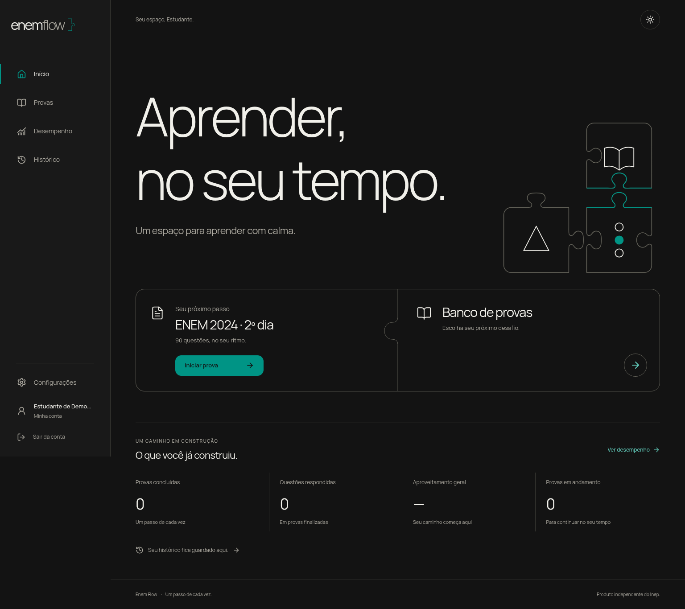
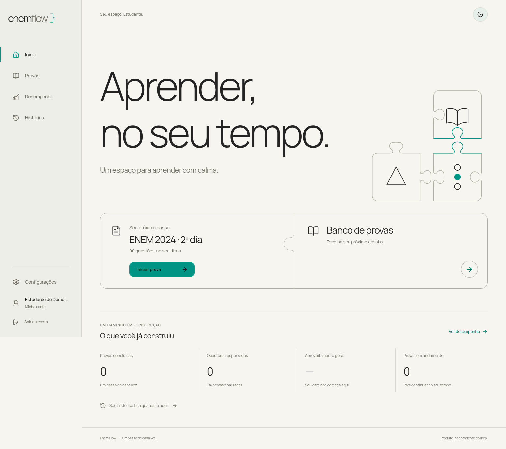

# Design atual — Conhecimento em construção

Atualizado em **31/10/2026**. Esta pasta reúne o design aplicado ao site, com prévias obtidas da implementação atual.

## Prévias

| Tema escuro | Tema claro |
| --- | --- |
|  |  |

[Ver a versão para celular](proposta-mobile.png).

As capturas desktop têm 1536 × 1366; a captura móvel tem 390 × 1481. Os nomes e indicadores exibidos são dados de demonstração.

## Identidade visual

- Fundos neutros, verde `#009485` e tipografia Manrope.
- Título de entrada grande e leve, com peso 300; textos em peso regular e botões em peso 600.
- Barra lateral fixa no desktop e menu recolhido em telas menores.
- Cartões de ações lado a lado no desktop e em coluna no celular.
- Ilustrações em SVG, com o mesmo traço e as mesmas cores dos componentes.

## Geometria dos encaixes

As três peças representam leitura, raciocínio e prática. Cada uma tem um contorno fechado, com pinos de pescoço estreito e cavidades correspondentes. Há dois perfis: cabeça arredondada e cabeça mais larga.

As peças aparecem afastadas. Cada par vizinho usa exatamente a mesma curva em sentidos opostos; ao voltar à grade comum, suas bordas coincidem. A separação não depende de sobreposições nem de linhas soltas para sugerir uma conexão.

Os cartões de ações permanecem unidos por uma única divisória com formato de encaixe. O detalhe da marca usa o mesmo perfil arredondado.

## Paleta implementada

| Uso | Tema escuro | Tema claro |
| --- | --- | --- |
| Fundo | `#131313` | `#F6F5F0` |
| Painéis | `#171717` | `#F6F5F0` |
| Barra lateral | `#191919` | `#EEEEE8` |
| Texto principal | `#F1F0EA` | `#242424` |
| Texto de apoio | `#AAA79E` | `#706F65` |
| Bordas discretas | `#383833` | `#D8D6CC` |
| Contornos das peças e cartões iniciais | `#626158` | `#B0AEA3` |
| Acento e ação principal | `#009485` | `#009485` |
| Texto da ação principal | `#131313` | `#131313` |

[Ver paletas](paletas.svg). A preferência de tema é salva no navegador; na primeira visita, o site acompanha a preferência do sistema.

## Arquivos da implementação

- [Geometria compartilhada](../../frontend/src/lib/puzzle-geometry.ts).
- [Marca, peças e divisória dos cartões](../../frontend/src/components/design.tsx).
- [Página inicial](../../frontend/src/components/dashboard.tsx).
- [Estilos e adaptação para telas menores](../../frontend/src/app/globals.css).
- [Troca de tema](../../frontend/src/components/theme-toggle.tsx).

Os textos e controles da interface são elementos HTML. Os enunciados e as alternativas continuam sendo conteúdo nativo do JSON; a decoração permanece fora da área de leitura das questões.

## Conteúdo desta pasta

- `proposta-escura.png`: captura atual do desktop no tema escuro.
- `proposta-clara.png`: captura atual do desktop no tema claro.
- `proposta-mobile.png`: captura atual do celular.
- `paletas.svg`: cores da implementação.
- `README.md`: direção visual e caminhos do código.

As imagens do estudo inicial, seus prompts e a pasta de referências foram retirados desta pasta.
